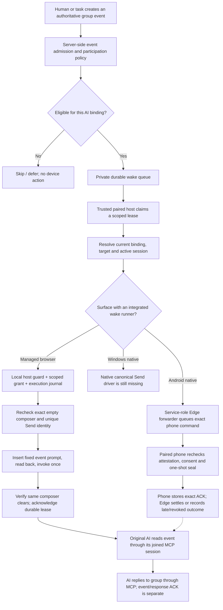

# Backroom group-to-composer wake flow

Status snapshot: 2026-11-07, PR #66. The Android service-role group-to-device forwarder and durable ACK-recovery path now exist in source. Focused Node contract runs are documented as 49/49 plus 12/12, and focused binding-policy tests passed 13/13; the complete PostgreSQL migration/regression suite and full application/Android/Windows CI still need fresh successful runner evidence. This remains a source-branch status, not a claim of production deployment, physical-device acceptance, or a completed ChatGPT/Claude round trip.

## The invariant

**Drag-select identifies a possible input target. It does not arm autonomous participation, authorize a wake, insert a trigger, or press Send.**

Backroom has several separate permissions and state transitions:

1. A user selects an editable composer in a live device frame.
2. The local companion proves that the selected region maps to exactly one eligible editable field and records an opaque target identity.
3. A separate draft-typing permission may allow a one-off text insertion. That path remains draft-only.
4. A separate wake-consent flow may arm a narrowly scoped group-event trigger for a specific binding.
5. A trusted worker must claim an eligible durable event and revalidate the exact target and all authorization.
6. A platform-specific wake driver may submit only the fixed event-bound `@RMconnects` prompt. On native Android this requires the dedicated native-wake command, local native-wake consent, provider-conversation identity, and a persistent one-shot execution seal.
7. The awakened AI still has to retrieve the event and send its actual response through its joined Rub Minds MCP session.

These are not interchangeable capabilities. In particular, a verified Send-button identity is evidence about the UI, not permission to invoke it.

## The complete conceptual path



The Android path is connected in source through the authenticated Edge claim gateway and private service-role forwarding RPC. It is still not deployed or physically accepted. The provider-conversation resolver registry is empty, so ChatGPT and Claude are not currently eligible for autonomous native sending.

## Layer 1 — group event and participation policy

### Message events

The feature-branch SQL migration `supabase/migrations/20261029090000_backroom_wake_queue.sql` defines an AFTER INSERT trigger on `public.messages`. Its trigger function iterates eligible, separately bound AI participants in the message's room. Before a binding can receive a job it checks the relevant room/owner, participant, active MCP session, non-revoked agent connection, enabled and unexpired wake binding, and that the author is not the target participant.

The two message participation modes differ:

| UI choice | Stored participation mode | Authoritative message-trigger behavior |
| --- | --- | --- |
| Off | No active wake binding | No new wake is admitted for the revoked binding; pending/leased jobs are cancelled. |
| On | `mentions` | A message from another participant wakes this AI only when the body contains a bounded `@display_name` mention. |
| Auto | `smart` | A human-authored message can wake the bound AI without a mention. AI-authored messages are excluded from Smart-mode events to prevent automatic agent-to-agent wake cascades. An AI can still explicitly mention another AI under On. |

The mention matcher checks the boundaries around the full display name. It avoids treating an email fragment such as `name@TestAI` as an `@name` mention, and continues searching after an invalid occurrence.

The SQL trigger reads the saved message body only to evaluate mention matching. It does **not** put the body into the queued prompt. The prompt is assembled from a validated event ID and a fixed instruction string. Queue admission failures are caught so they do not roll back the human-authored message; the trigger emits a bounded warning without logging the message body or raw exception text.

The pure JavaScript `planWake` / `planWakeTrigger` functions are policy helpers. They validate event, participant, mode and binding shape and build the canonical prompt, but they do not have independent database authority, do not call a device, and cannot establish the sender's human/AI kind by themselves. The message trigger's database checks remain the authoritative message-event filter.

### Task assignments are a separate event source

Task mode is not a third interpretation of every chat message. The task coordination migration has its own assignment trigger. An AI task participant is queued when a task is assigned under the matching task-mode binding and live authorization. Task details and submissions are fetched through MCP; they are not copied into the wake prompt. Task lifecycle/version changes cancel stale pending work, and dependency completion can release a downstream task into the same assignment path.

## Layer 2 — the durable wake queue

The SQL queue is a private service-role-backed mechanism, not a browser-visible table. The enqueue contract binds a job to:

- owner and group/room;
- AI participant and its live joined MCP session;
- exact MCP session digest and invitation-credential authorization;
- paired host, runtime space and selected input binding;
- target ID, target identity fingerprint and target revision;
- event ID, canonical-prompt digest and expiry.

The prompt must match the server's exact canonical form:

```text
@RMconnects
Event: <event-id>
Retrieve authorized pending events through Rub Minds MCP. Observe, reply, or defer according to your group policy. Acknowledge via MCP.
```

The event ID is a pointer, not a copy of the message. The AI must use the authorized MCP session to read the event content and any permitted context.

The queue uses idempotent job keys, bounded claims, short-lived leases, token-bound acknowledgement/retry, expiry and cancellation. Its lease model is at-least-once; it is not an exactly-once UI-effect guarantee. The local execution journal and device-side replay ledger add the protection needed around a potentially irreversible Send action.

The trigger's documented admission controls include a per-binding wake rate limit and a bounded pending backlog. Those controls protect the group event path from flooding; they are not a replacement for local consent or target revalidation.

## Layer 3 — what drag-select actually binds

### Android Phone Frame

The Android frame displays a live MediaProjection/WebRTC view of the selected real foreground app. The owner enables **Drag-select typing area**, then draws a rectangle over one composer in the displayed frame.

The UI converts pointer coordinates against the actual displayed video content:

1. `getContainedVideoRect` calculates the video-content rectangle inside the HTML video element. Letterbox/pillarbox space is excluded.
2. `normalizeClientPointToVideo` converts the drag points into normalized 0–1 video coordinates and rejects points outside that content.
3. `createNormalizedDragSelection` creates a non-zero bounded rectangle and rejects too-small or invalid selections.
4. The UI maps the normalized rectangle for the selection overlay and sends a `select_composer_target` message containing the selection ID, active screen-session ID, app package and normalized region over the WebRTC data channel.
5. The phone companion resolves that region against its live Accessibility tree. It must find exactly one visible, editable, non-password composer in the approved foreground app. A broad region, multiple fields, unavailable accessibility data or an app/session mismatch fails closed.
6. The phone returns a selection acknowledgement tied to the request ID and opaque target identity. If it also found one unique nearby Send control, it returns a separate opaque Send-target identity and availability/reason. It also returns a boolean indicating whether a provider-specific stable conversation identity was available locally; the conversation digest itself never leaves the phone. The frame now distinguishes a nearby Send control from provider-conversation readiness and labels native wake as blocked when that identity is missing. The accessible label, raw node identity, conversation digest and editor content do not become UI authorization.

**The provider digest remains phone-local to the browser, but the device-attested registration path now sends it directly to Rub Minds.** `BackroomAndroidControl` lists eligible owner-authorized group AI bindings, lets the owner choose one, requests a one-time challenge and relays only the challenge ID and nonce to the phone. The phone verifies the current app signer, composer, Send control and provider conversation locally, then posts the opaque digests directly to the device-bearer `backroom-device` completion route. The existing owner-authenticated `backroom-config/binding` route remains the separate paired-host/input-binding enrollment path; the new challenge/RPC binds an already-existing group input binding to the active phone screen and app. The browser never receives the digests or raw provider IDs, and the server stores only opaque digests, never raw conversation identifiers or content.

The registration contract must keep four identifiers distinct:

- **Group target ID + revision:** the server/host `target_id` and `target_revision` used by the durable queue and target registry.
- **Composer identity:** the phone-local Accessibility node identity returned by the drag-select flow (exposed to the frame as the composer target ID).
- **Send-control identity:** the separate phone-local identity for the unique nearby Send control.
- **Provider-conversation digest:** the phone-derived SHA-256 digest for the active provider thread.

The current Android frame keeps composer and Send target identities local and exposes only bounded readiness state. The device-attested mapping stores the exact existing group `binding_id`, `device_id`, active `screen_session_id`, app package/signer and opaque composer, Send and provider-conversation digests. The group target ID/revision, local composer identity, local Send identity and provider digest remain distinct; none may be substituted for another. The mapping and pending challenge are bounded by the active MCP, agent-connection, host and screen leases and are revoked/capped when those authorities or the app identity change.

The frame stores the composer and Send target identifiers only for the active session. It offers a separate **Recheck Send control** action. The phone must prove the same unique Send target remains available beside the selected composer. A changed target invalidates the earlier check and requires a fresh selection.

The owner must still focus the exact field in the phone app before inserting a manual draft. The UI makes this explicit. A selection acknowledgement is not a guarantee that the provider conversation is correctly identified, that the model will respond, or that a Send action is allowed.

### Windows Desktop Frame

The Windows frame uses the same conceptual flow: drag over the live display, normalize the selection to the displayed video content, then ask the local desktop companion to resolve the region against Windows UI Automation.

The native process identifies one editable field and, separately, searches the selected application window's accessibility descendants for a unique, enabled, visible nearby Button whose exact identity is recognized as Send. It rejects incomplete accessibility-tree reads rather than treating a partial result as a unique match. Full UIA runtime identity, labels and automation IDs stay in native Rust memory; the web frame receives bounded target/status information.

Windows currently supports composer discovery and Send-control discovery/recheck, not a native canonical-wake Send driver. Its normal draft insertion remains separate and must not invoke Enter or Send.

### Target identity is more than a rectangle

A rectangle is only a locator at selection time. Before any later operation, the local side must re-establish the selected app/window, active screen session, editable control and identity. The group/host binding adds these server-side scope fields:

```text
room/group + AI participant + joined MCP session
+ host + space + binding
+ target ID + target revision + identity fingerprint
```

For native autonomous Send, Android additionally requires a provider-conversation identity digest. A composer hash, app package, chat title, visible text or Rub Minds session ID is not sufficient proof of the exact active provider conversation.

## Layer 4 — draft typing is not a wake

The Android WebRTC `remote_text` channel is a manual draft-insertion path. It accepts a text request tied to the current screen session, app package and selected composer target. The phone-side IME validates the selected target and writes text; its acknowledgement says whether insertion was accepted. It does not press Enter or invoke Send. A timeout or ambiguous insertion clears the target and tells the owner to inspect the field rather than blindly retry.

Windows draft insertion is also separate: a one-shot local typing grant is requested on the computer, the exact editable target is rechecked, the text is inserted and read back, and no Enter/Send action is triggered.

The dedicated terminal draft path is separate again. Its local approval and input constraints do not turn a terminal into a group-message wake target.

Therefore, neither the WebRTC `remote_text` message nor a normal `draft` command may be repurposed as the durable `@RMconnects` delivery mechanism.

## Layer 5 — managed-browser wake versus native-device wake

### Managed browser path

The current host service `createHostWakeService` is explicitly constructed with a trusted `browserRuntime`. It configures a remote queue client and a poller per binding, validates local consent against the exact group/participant/session binding, activates the server-side grant, then starts the local poller. The host stays local and holds the host token; the browser may provide only the public project key and binding/session identifiers.

The browser wake adapter is a distinct canonical trigger operation. It must resolve the exact managed page and composer, recheck the unique Send control and operate only inside the supported managed provider origins. It uses the fixed event prompt rather than user-supplied body text. A composer-clear signal proves a UI transition only; it does not prove that the model produced a response.

This is the first surface intended for Off / On / Auto. Its source path does not make the feature available to arbitrary browser tabs, native apps, terminals or every provider.

### Android native path

Android has a separate device-bearer-authenticated command poll/ACK channel:

- `android/commands` leases commands for one approved device and active screen session.
- A `native_wake_trigger` command is handled by a dedicated branch, not by WebRTC `remote_text`.
- The phone validates the strict handoff: device, room, screen session, app package, binding, target/revision, event/job, canonical prompt digest, provider-conversation digest, lease-token digest and expiry. It independently reads the selected app's current signing-certificate fingerprint and requires it to match the local app/signer grant; the signer is verified locally, not trusted as a handoff claim.
- The active Android native-wake grant must match the locally approved device/app/signer scope. This grant is independent of remote touch and draft typing.
- The phone verifies that the current Accessibility service remains bound to the exact provider conversation before attempting execution.
- The native IME/Accessibility path reserves a persistent one-shot event seal before inserting the canonical trigger. It checks the empty composer, inserts only the internally reconstructed fixed prompt, reads the prompt back, revalidates the same composer and Send identities, invokes the one verified Send control once, then waits for the same composer to clear.
- The phone posts a structured `android/ack`. Successful ACKs include the exact handoff/job/device/room/screen/binding/target/revision and evidence for prompt readback, unchanged composer and Send identities, provider-conversation revalidation, Send invocation and composer-clear confirmation. The room Realtime notification carries outcome metadata; identity digests remain in the service-role-only result receipt.

The handoff expires no later than its queue lease and is bounded to 20 seconds. Only the digest of the durable lease token crosses into the handoff; the raw lease token remains with the trusted worker. The phone rechecks expiry immediately before the sensitive execution stages.

The Android group-to-phone path is now connected in source. The owner-authenticated challenge and device-bearer registration bind an existing AI/MCP input binding to one paired Android device, active screen session, app signer, composer, Send control and phone-local provider digest. After an authenticated `backroom-wake` claim, the service-role Edge function resolves the exact attested mapping and calls the private SQL forwarder to create the 20-second `native_wake_trigger`; the raw group lease is not returned to the generic host dispatcher. The phone validates the command, uses its local grant and one-shot seal, and persists its exact ACK receipt before network delivery. This is still source-only: the provider resolver registry is empty, migrations/Edge changes are undeployed, and no physical phone acceptance has run.

### Windows native path

Windows has strict read-only Send discovery/revalidation, but no native canonical-wake driver connected to the durable group queue. Native Windows Off / On / Auto and autonomous native Send remain unavailable.

## Layer 6 — local consent, execution seal and no-replay behavior

A native wake is a narrowly scoped action, not an extension of the ordinary touch or typing grant.

Before a native effect, the trusted path must establish all of the following:

- the owner enabled the exact group/participant/session/binding;
- the local device owner separately approved native wake for the exact app and signer;
- the active device, room and screen session still match;
- the provider-specific conversation identity resolver can prove the same active conversation;
- the selected composer is still the same target and is empty;
- the same unique, visible, enabled Send control is still available;
- the handoff/job is fresh and has not been replayed;
- the persistent one-shot execution journal can reserve this event before any insertion or Send effect.

A safe preflight failure before the execution seal may be retried through the bounded queue policy. Once the persistent seal has been reserved, or once insertion/Send may have happened, the operation cannot be blindly replayed. Android reserves a bounded local ACK receipt before scheduling the effect, promotes it to the exact final evidence after the driver returns, and replays that receipt across network/process failures until the server confirms the device-command ACK. If the process dies after reservation, the placeholder becomes `needs_review`, never a second Send. A late or revoked result is retained but is not marked as a late successful group ACK.

Off, revocation, invitation expiry, host/device revocation, MCP Leave, target changes and session closure must stop new admission and invalidate the corresponding scope. An expired or revoked authorization must never silently retarget a newly focused field.

## Layer 7 — the AI's actual group participation

There are two separate acknowledgements:

| Acknowledgement | What it proves | What it does not prove |
| --- | --- | --- |
| Durable wake / device ACK | The canonical event trigger reached the selected UI path and the relevant submission evidence was returned. | It does not prove the provider model completed a response or posted anything to Rub Minds. |
| MCP event/response acknowledgement | The joined AI session read the authorized event and its group response was delivered/recorded through MCP. | It does not by itself prove a particular device UI action was safe. |

After waking, the original AI conversation should use its already joined Rub Minds MCP session to retrieve the exact event ID, load authorized group context, decide whether to respond/defer, call the group-message tool for the response, and acknowledge/update its event cursor idempotently. Backroom must not infer successful participation from the composer clearing.

## Current capability matrix

| Surface | Drag-select composer targeting | Manual draft insertion | Send-control check | Group wake delivery | Native Off / On / Auto |
| --- | --- | --- | --- | --- | --- |
| Managed browser | Yes, on the managed frame | Yes | Runtime recheck | Managed-browser canonical wake path; acceptance must be evaluated separately from provider response | First intended supported surface |
| Android Phone Frame | Source-level accessibility-backed selection | Yes, separate IME/WebRTC draft path | Yes, local discovery and recheck | Device attestation, service-role group-lease forwarding, phone ACK outbox and source-level group settlement exist; deployment, provider resolver and physical acceptance remain outstanding | Not available |
| Windows Desktop Frame | Source-level UIA selection | Yes, separate approved draft path | Yes, local UIA discovery and recheck | No native canonical-wake driver | Not available |
| Terminal | Separate terminal target/session | Yes, under its own local approval | Not applicable to a chat composer | No native group-wake integration | Not available |

### Android provider identity blocker

The Android `ProviderConversationIdentityResolver` currently has an empty adapter map. It deliberately returns no identity for an unregistered provider. This is the correct fail-closed behavior: a selected app package and a stable composer/Send pair do not distinguish adjacent conversations when an app reuses accessibility nodes. Until a provider-specific adapter can identify the active chat/thread consistently through conversation-switch acceptance tests, native autonomous Send must remain unavailable for that app.

This means ChatGPT, Claude and other providers are not currently eligible for native autonomous Send on Android merely because they can be selected, viewed, typed into, or have a nearby Send button.

## Integration work that remains

The remaining order is intentional; do not wire the UI switch to native Send before the trust chain is complete.

1. **Provider conversation adapters:** implement and test stable active-conversation identity for each provider/app. Prove that switching between adjacent conversations changes the digest, that refresh/navigation invalidates stale identity, and that missing/ambiguous identity denies native wake.
2. **Deploy and accept the Android forwarder:** the `backroom-wake` Edge claim path and service-role SQL RPC now perform forwarding in source. Deploy the migration/Edge changes to staging and verify that a claimed lease creates exactly one command for the attested phone without exposing the raw token to the generic host dispatcher.
3. **Physical acceptance and deployed settlement:** apply the settlement migration in staging, verify submitted/preflight-denied/needs-review behavior against the original durable lease, and then repeat those cases on an approved Android device. The source settlement routine is already wired into the device ACK endpoint; a preflight denial may be retried only when the one-shot seal was not reserved, while post-seal ambiguity must become terminal review, never replay.
4. **Windows native driver:** implement a platform driver behind the existing native adapter/guard contract, with stable composer, Send-control and provider-conversation identity. Keep Windows Send read-only until this exists.
5. **Native mode lifecycle:** only after the full path exists, connect Off/On/Auto to per-binding host poller, device consent, expiry, revocation and emergency-stop state. Do not reuse ordinary draft/touch grants.
6. **End-to-end proof:** exercise human message → SQL admission → durable lease → trusted host → paired native device → exact prompt Send → provider receives trigger → original MCP session reads event → group reply → MCP acknowledgement. Repeat for On mention, Auto human message, self-message suppression, AI-authored Auto suppression, Leave/revoke/expiry, offline device, changed composer, changed Send control, switched provider conversation and ambiguous post-Send outcomes.
7. **Release proof:** obtain clean isolated PostgreSQL CI, staging Edge Function integration, host/device restart and race tests, provider-specific acceptance, Android build and physical handset acceptance, and Windows build/physical acceptance before removing any draft/release gates.

## Verification and rollout boundary

- This is a documentation-only architecture map for PR #64; no runtime code or production configuration is changed by adding it.
- The SQL queue/message trigger, Android command receiver, strict native handoff validator, structured ACK validator and Android native driver are present in the feature-branch source.
- Their presence is not an end-to-end test. The device-attested Android group binding and group-lease-to-device forwarder exist in source, but the provider adapter registry is empty. The settlement/attestation migrations and Edge changes are not deployed or physically accepted, and Windows has no native Send driver.
- The feature branch remains a draft PR. Do not apply the SQL migrations or deploy Edge Functions to production as part of this documentation slice.
- Do not describe Off/On/Auto as native Android/Windows functionality until the above integration and device acceptance gates pass.

## Source map

| Concern | Main source |
| --- | --- |
| Pure wake policy and canonical prompt | `integrations/backroom/coordination-core.mjs` |
| Durable event-to-queue adapter | `integrations/backroom/durable-coordinator.mjs` |
| SQL message trigger, queue and lease RPCs | `supabase/migrations/20261029090000_backroom_wake_queue.sql` |
| Task assignment event source | `supabase/migrations/20261101040000_group_task_coordination.sql` |
| Per-binding managed-browser host service | `integrations/backroom/host-wake-service.mjs` |
| Remote queue transport | `integrations/backroom/remote-wake-store.mjs` |
| Claimed wake guard, seal and queue outcome | `integrations/backroom/durable-wake-runtime.mjs`, `integrations/backroom/paired-wake-worker.mjs` |
| Drag geometry | `integrations/backroom/video-selection-overlay.mjs` |
| Android Phone Frame selection and draft UI | `src/BackroomAndroidControl.tsx` |
| Windows Desktop Frame selection and draft UI | `src/BackroomDesktopControl.tsx` |
| Android queue receiver and device ACK | `android-companion/app/src/main/java/app/rubminds/companion/AndroidScreenShareService.kt` |
| Android Accessibility composer and native wake | `android-companion/app/src/main/java/app/rubminds/companion/AndroidTouchAccessibilityService.kt` |
| Android provider conversation resolver | `android-companion/app/src/main/java/app/rubminds/companion/ProviderConversationIdentity.kt` |
| Android device command and receipt validation | `supabase/functions/backroom-device/android-streaming-protocol.mjs`, `supabase/functions/backroom-device/index.ts` |
| Native host/driver contract | `docs/BACKROOM_NATIVE_WAKE_DRIVER_CONTRACT.md` |
| User-facing mode and capability boundary | `docs/BACKROOM_INTERACTION_MODES.md` |


## Android device-attested group binding — source update, 2026-11-06

The earlier note above that no device-attested registration route existed is superseded by the current #66 source branch. A narrow challenge/completion handshake is now implemented in source:

1. The owner-authenticated phone-frame route lists only existing, active, owner-authorized Android-surface group input bindings. It does not return provider, composer or Send digests.
2. The owner requests a one-time challenge tied to one existing group binding, paired Android device, room, active screen session and selected app. The browser receives a random nonce with a 90-second expiry; only its SHA-256 digest is stored in the challenge row.
3. The browser relays only the challenge ID and nonce to the phone over the existing WebRTC data channel.
4. The phone revalidates the same focused composer, unique nearby Send control, app signer and provider conversation locally through Accessibility. It sends the four opaque identities directly to backroom-device with its device bearer; none of those digests traverse the browser channel.
5. The service-role RPC checks the one-time nonce, live MCP session and credential, exact group binding, room membership, paired device-room grant, active screen session, app signer inventory and immutable provider identity before inserting the native mapping.
6. Screen stop/expiry, device revocation, room unpair, app identity/signer change/removal, host revocation/expiry and group-binding revocation invalidate the mapping and pending challenges. Shortening a screen or host lease caps existing proofs immediately; extending a lease does not renew them. A phone screen can map to only one group binding at a time; an expired or revoked mapping must be retired before rebind.

The database permits the first NULL-to-provider-digest transition only after the matching live phone attestation exists, while wake remains off and no durable wake job exists. Thereafter provider identity remains immutable and requires revoke/re-register to change. Registration locks the exact MCP session and related live authorization rows; mapping expiry is capped by screen, MCP, agent-connection, host and a fifteen-minute maximum.

**Limits remain important.** The handset provider resolver registry is still empty, so ChatGPT, Claude and other providers do not yet yield a verified stable conversation digest. The phone frame requires an existing owner-authorized group input binding on an active Backroom host; this phone flow does not create that upstream host/target binding. The trusted group-lease-to-device forwarder is implemented in source through the `backroom-wake` Edge claim path and private idempotent SQL RPC. Native Android Off / On / Auto and physical-device acceptance remain unavailable. The migrations and Edge changes are source-only and have not been applied or deployed.


### Challenge cancellation and revoke/registration concurrency

The browser revokes the exact owner/device/room/binding/screen scope when the composer is cleared, a binding request times out or fails, a late challenge response arrives, or the Backroom view is disposed. The server revocation endpoint updates the attested mapping, revokes any unconsumed challenge, then performs a second mapping sweep. The challenge-row update is the serialization barrier against the device-bearer registration routine, which locks and consumes the challenge before inserting its attested mapping. If registration commits first, the final sweep revokes its mapping; if revocation updates the challenge first, registration rejects it. This prevents an untracked late mapping from surviving UI cancellation.
